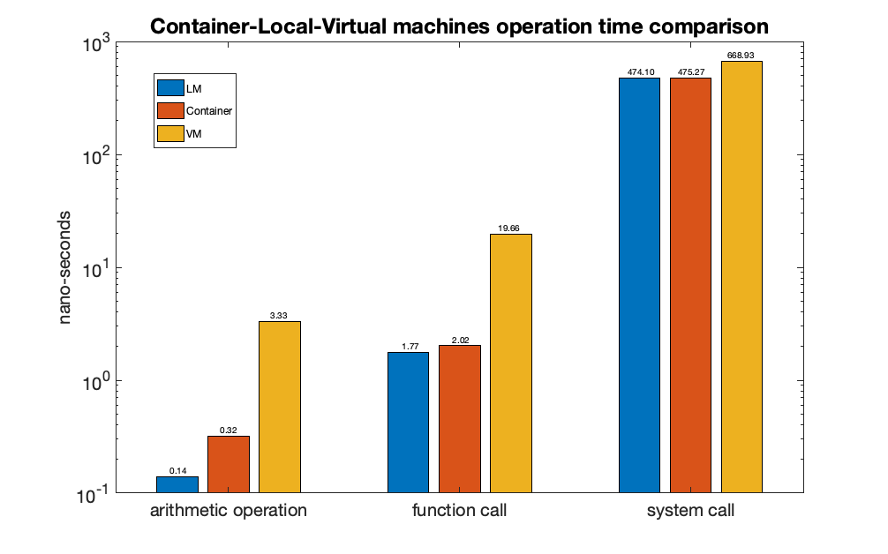

# Measuring operation times

`osm.cpp` is a small static library (`libosm.a`) that measures the average time in nanoseconds of:

* a single addition
* an empty function call
* a trap, using an empty system call

Each operation runs many times between two `gettimeofday` calls, 10 times in every loop iteration (loop unrolling), and the time of the same loop without the operations is taken off, so only the operations are counted.

We ran it on a lab computer, inside a VM (Tiny Core Linux on QEMU) and inside a Singularity container:

A trap takes a few hundred nanoseconds, way more than an addition or a function call. The container is almost as fast as the computer itself, while the VM is slower in everything.

## Following a program with strace

An unknown program, followed only by its system calls. It requires an argument, after it is supplied with one, it creates the directories `Welcome` and `Welcome/To`, and creates and opens a file inside them. Then it writes a username and a short message into the file. After this, the file is removed with the `unlink` function, and the directories `Welcome` and `Welcome/To` are removed as well.

## How to build

Put `osm.h` (the interface header, not included here) next to `osm.cpp` and run `make`, it builds `libosm.a`.
